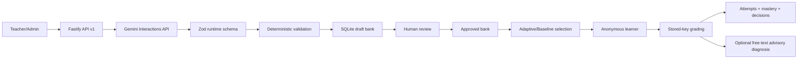

# Kiến trúc AI Core

Kho mã ban đầu trống, không có Git, frontend, backend, database hay tests cần giữ lại. Kế hoạch đã thực hiện: (1) cấu hình và generation/persistence; (2) taxonomy, grading, diagnosis và learner model; (3) approval, auth, giới hạn chi phí, logging, tests và tài liệu. Không huấn luyện/fine-tune mô hình.

## Luồng dữ liệu

`src/ai.ts` là adapter độc lập, sử dụng SDK Google chính thức, cấu trúc JSON Schema và kiểm tra Zod sau nhận dữ liệu. Prompts có phiên bản trong `src/prompts.ts`. Gemini chỉ tạo câu mới và phân tích câu trả lời tự do không khớp đáp án; không quyết định mastery, nhóm thí nghiệm hay câu trả lời MC đúng/sai.

`src/domain.ts` kiểm tra count, phạm vi thì/độ khó/loại câu, taxonomy, options trùng theo Unicode/case/whitespace, duy nhất đáp án khớp key, mapping đáp án đúng phải null và một chỗ trống cho fill-in. Hash nội dung chống trùng giữa các batch; toàn bộ batch ghi trong transaction. Các kiểm tra này **không chứng minh chỉ có một đáp án đúng về nghĩa**. Mọi câu có cờ yêu cầu giáo viên kiểm tra ngữ pháp, độ tự nhiên, độ khó và distractor mapping; chỉ `draft` được duyệt/từ chối. Người duyệt, thời điểm, ghi chú và attestation được lưu. Câu rejected không được phục vụ.

## Persistence

Prisma/SQLite lưu Topic, ErrorCategory, Skill (tense + error), Question, AnswerOption, Student, Attempt, MasterySnapshot, SelectionDecision, AiUsage và DiagnosisCache. Migration có SQL để tái lập schema. Quan hệ cascade khi xóa học sinh xóa attempts, mastery, decisions; giữ kho câu và usage không có student ID. Chỉ lưu hash SHA-256 của bearer token học sinh. Không thu thập họ tên/email/địa chỉ.

Student ID là UUID ẩn danh. Mode và experimentGroup do admin gán khi tạo, học sinh không tự đổi. Mỗi assignment có decision ID và chỉ nhận một lần nộp (unique constraint); GET next lặp lại trả assignment đang chờ. Lý do lựa chọn, phiên bản thuật toán và nhu cầu sinh nội dung được lưu. Khi thiếu câu phù hợp, dùng fallback đã duyệt nếu có và ghi yêu cầu cho staff; không phát câu chưa duyệt cho học sinh.

## Bảo mật và quyền

Admin/teacher dùng credentials server-side trong `.env`, không có giá trị mặc định hoạt động. Teacher quản lý kho nội dung; admin có quyền model nâng cao, tạo học sinh, usage và export. Học sinh chỉ truy cập hồ sơ của chính token của mình. Không có API liệt kê hồ sơ công khai. API trả câu cho học sinh dùng allowlist, không lộ correctAnswer, explanation hoặc distractor mapping trước submission. Diagnosis chỉ nhận attemptId đã nộp thuộc người gọi.

Body tối đa 16 KiB, các chuỗi/count có giới hạn và request schemas strict. Rate limit theo IP: 120/phút chung; endpoint generation, diagnosis và submission dùng hạn mức AI cấu hình. Không trust proxy mặc định; nếu đặt proxy phải cấu hình forwarding và shared limiter phù hợp. Logging HTTP tự động bị tắt; authorization redacted; lỗi SDK không được gửi nguyên văn. Không log body, prompt, API key hoặc đáp án học sinh.

## Tích hợp game sau này

Frontend đăng nhập qua hệ thống tài khoản của trường rồi nhận session/token từ backend; không lưu staff token hay Gemini key trong game. Game gọi next-question, hiển thị options, gửi decisionId + answer và hiển thị kết quả. Kết nối SSO/session có thời hạn, phân quyền theo lớp, CORS allowlist nếu khác origin, UI duyệt câu và hàng đợi content-needs là phần tích hợp tiếp theo. Token bootstrap hiện tại phù hợp demo/local, chưa có thu hồi/rotation staff token tự động hoặc đăng nhập mật khẩu.
